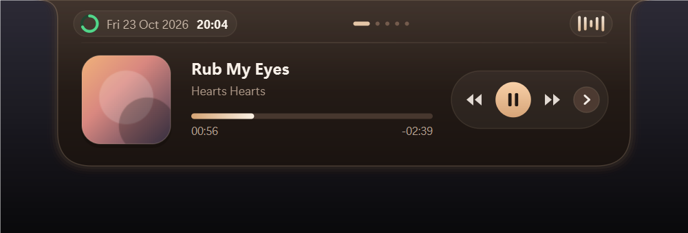

# Noktah

> Notch pemutar musik untuk Windows yang menempel di tepi atas layar.

Panel hitam kecil yang menggantung di atas layar Anda dan menunjukkan lagu yang
sedang diputar — lengkap dengan sampul album, judul, artis, jam, bilah progres,
dan tombol kontrol. Saat tidak dipakai ia menyusut jadi tab mungil; saat disorot
(atau saat lagu berganti) ia turun membesar dengan animasi pegas.



Saat ringkas, Noktah cuma tab kecil berisi sampul + equalizer yang bergerak:


## Fitur

- **Menempel di tepi atas layar** — sudut atas menyatu dengan tepi layar, sudut
  bawah membulat, dengan lekuk halus di kedua ujungnya.
- **Animasi pegas** (spring), bukan animasi linear — membesar/menyusut terasa
  hidup, dengan sedikit overshoot seperti Dynamic Island.
- **Konten lengkap**: sampul album, judul, artis, tanggal & jam, bilah progres
  dengan waktu berjalan dan sisa waktu, serta dock tombol prev / play-pause /
  next.
- **Warna aksen otomatis** — glow, equalizer, dan bilah progres mengambil warna
  dari sampul album; kalau sampulnya hitam-putih, dipakai warna khas per lagu.
- **Tanpa API key** — membaca Windows Media Session (SMTC), jalur resmi yang
  sama dipakai tombol media di keyboard. Bekerja dengan YouTube Music/YouTube di
  Edge/Chrome, Spotify Web, dan pemutar lain yang mendukung SMTC.
- **Seek dari bilah progres**, geser panel, klik tembus di area transparan.
- **Ringan**: jendela tidak pernah di-resize saat animasi, hanya area yang
  berubah yang digambar ulang (~7% CPU saat memutar lagu pada 60 fps).

## Kebutuhan

- Windows 10 / 11
- Python 3.10
- Paket: `PySide6` dan `winsdk`

## Download (tanpa Python)

Ambil dari halaman [Releases](https://github.com/Rizuki25/Noktah/releases):

| File | Untuk |
| --- | --- |
| `Noktah-Setup-1.0.0.exe` | Installer GUI mandiri (tanpa folder `%TEMP%`): pasang ke folder pilihan, buat shortcut, autostart, dan uninstaller (`Uninstall-Noktah.exe`) |
| `Noktah-1.0.0-win64.zip` | Portable: ekstrak di mana saja, jalankan `Noktah.exe` — atau klik `Install-Noktah.cmd` untuk memasang |

**Cara memasang**:

1. **`Noktah-Setup-1.0.0.exe`** — klik dua kali langsung, pilih folder tujuan (default: `%LOCALAPPDATA%\Programs\Noktah` atau lokasi lain seperti `D:\Noktah`), lalu klik **Pasang Sekarang**. Installer ini mengekstrak aplikasi langsung dari memori **tanpa membuat folder sementara (`is-*.tmp`) di `%TEMP%`** serta otomatis meminta elevasi izin (UAC) bila file berada di folder terbatas atau folder tujuan memerlukan izin tulis tambahan, sehingga bebas dari `Error 5: Access is denied`.
2. **`Install-Noktah.cmd`** di dalam ZIP — alternatif skrip teks yang menyalin aplikasi ke `%LOCALAPPDATA%\Programs\Noktah`, membuat shortcut Start Menu & Desktop, dan menaruh `Hapus Noktah.cmd`.

> Windows SmartScreen mungkin menampilkan "Windows protected your PC" karena
> exe-nya belum ditandatangani. Klik **More info → Run anyway**.

## Menjalankan dari source

Kebutuhan: Windows 10/11, Python 3.10, paket `PySide6` dan `winsdk`.

```bash
git clone https://github.com/Rizuki25/Noktah.git
cd Noktah
py -3.10 -m pip install PySide6 winsdk
py -3.10 noktah.py
```

Atau klik dua kali `run_noktah.bat` (menjalankan tanpa jendela terminal dan
mengecek dependensinya lebih dulu).

Putar lagu di browser dulu, baru jalankan Noktah.

> Kalau `python noktah.py` gagal dengan `ModuleNotFoundError`, itu karena
> `python` di PATH menunjuk ke venv proyek lain. Pakai `py -3.10 noktah.py`.

## Build .exe sendiri

```bash
py -3.10 -m pip install pyinstaller     # sekali saja
py -3.10 build_tools/build.py --onedir  # hasil: dist/Noktah/Noktah.exe
py -3.10 build_tools/build_installer.py # hasil: dist/Noktah-Setup-*.exe (tanpa Inno Setup)
```

Ikon dibuat ulang otomatis lewat `build_tools/make_icon.py` (butuh Pillow).

## Kontrol

| Aksi | Fungsi |
| --- | --- |
| Sorot panel | membesar (expanded) |
| Klik saat ringkas | play / pause |
| Seret | geser panel; dilepas akan menempel lagi ke tepi atas |
| Klik / geser bilah progres | lompat ke posisi tersebut |
| Klik kanan | menu **Keluar** / **Tempel ke atas (tengah)** |
| Spasi / ← / → | play-pause / prev / next (saat panel terfokus) |
| Esc | keluar |

## Cara kerja

`noktah.py` terdiri dari dua bagian:

1. **`MediaBridge`** — thread asyncio yang membaca
   `GlobalSystemMediaTransportControlsSessionManager` (SMTC) tiap detik:
   judul, artis, status, posisi, durasi, dan sampul album. Perintah tombol dan
   seek dikirim balik lewat antrean ke sesi media yang sama.
2. **`Notch`** — widget PySide6 tanpa bingkai yang digambar manual dengan
   `QPainter`. Semua posisi diturunkan dari satu nilai pegas `0..1` (ringkas →
   membesar), jadi lebar, tinggi, radius, ukuran sampul, dan tata letak
   bergerak mulus bersama-sama.

Jendela berukuran tetap (tidak di-resize saat animasi) supaya Windows tidak
menahan render; area transparan di luar panel dibuat tembus klik lewat
`WM_NCHITTEST → HTTRANSPARENT`.

## Struktur

```
noktah.py                     # seluruh aplikasi (bridge SMTC + UI)
run_noktah.bat                # launcher klik-dua-kali
assets/noktah.ico             # ikon aplikasi
build_tools/make_icon.py      # generator ikon (.ico + .png)
build_tools/build.py          # build .exe (onefile/onedir) via PyInstaller
build_tools/build_installer.py# build installer GUI mandiri (tanpa Inno Setup / tanpa %TEMP%)
build_tools/SetupProgram.cs   # kode sumber C# installer & uninstaller GUI
build_tools/noktah.spec       # spec PyInstaller
docs/                         # tangkapan layar untuk README
```
